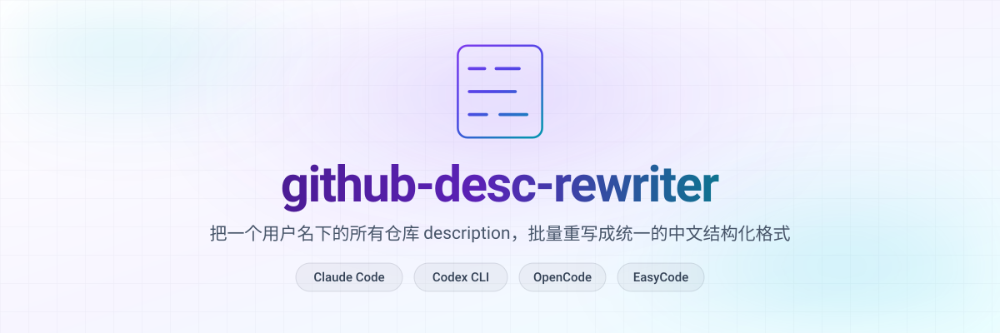

<p align="center">
  <picture>
    <source media="(prefers-color-scheme: dark)" srcset="assets/banner-dark.svg">
    <source media="(prefers-color-scheme: light)" srcset="assets/banner-light.svg">
    
  </picture>
</p>

<p align="center">
  <a href="https://github.com/mcgrapeng/github-desc-rewriter">
    
  </a>
  
  
  
  
  
  
</p>

<p align="center">
  <a href="https://github.com/mcgrapeng/github-desc-rewriter/stargazers">
    
  </a>
  <a href="https://github.com/mcgrapeng/github-desc-rewriter/network/members">
    
  </a>
  <a href="https://github.com/mcgrapeng/github-desc-rewriter/watchers">
    
  </a>
  <a href="https://github.com/mcgrapeng/github-desc-rewriter/issues">
    
  </a>
  
  
</p>

<p align="center">
  <a href="https://github.com/mcgrapeng/github-desc-rewriter">
    
  </a>
</p>

<p align="center">
  <a href="#-改造前后">改造前后</a> ·
  <a href="#-快速开始">快速开始</a> ·
  <a href="#-工作原理">工作原理</a> ·
  <a href="#-描述格式规范">格式规范</a> ·
  <a href="#-star-历史">Star 历史</a> ·
  <a href="#-贡献者">贡献者</a> ·
  <a href="#-license">License</a> ·
  <a href="#-english">English</a>
</p>

---

## ✨ 改造前后

一个命令，把 326 个仓库的 description 全部拉齐。

<table>
<tr>
<th width="50%" align="left">❌ 改造前</th>
<th width="50%" align="left">✅ 改造后</th>
</tr>
<tr>
<td valign="top">

仓库列表一眼扫过去，风格各异、看不出在做什么：<br><br>
<code>Lodestone</code> — 空描述<br>
<code>Real-time intelligence for emerging AI projects and tools</code> — 英文、看不出解决什么<br>
<code>🚀 AI 工具发现平台 📊</code> — emoji 堆砌<br>
一大段 400+ 字符的英文长句，GitHub 首页直接截断

</td>
<td valign="top">

统一为 <code>是什么 / 能干什么 / 解决什么问题 — 用户痛点 / 何时选它 — 决策建议</code>：<br><br>
<code>实时聚合 GitHub/HuggingFace/MCP Registry/arXiv 四大平台的 AI 项目情报多源雷达,中文仪表盘呈现 / 抓各平台趋势榜,按 Agent/RAG/代码生成/MCP 等 20 个用途分类,支持增量爬取、关键词过滤与本地部署 / 解决:找 AI 工具要在多个平台来回跳,趋势信息分散且时效差,中英文信息差大,缺一个统一筛选入口 / 何时选:想一站式刷最新 AI 项目、按用途给手头需求找工具时</code><br><br>
<code>自托管 PaaS 平台,Vercel/Netlify/Heroku 开源替代,应用/数据库/容器三件套 / 一条命令部署、自动 TLS、绑定自定义域名,资源与成本自己掌控 / 解决:用商业 PaaS 被平台锁定,升级降价受制于人且迁移成本高 / 何时选:想摆脱 SaaS 锁定、自己掌控数据与部署链路时</code><br><br>
<code>命令行模糊查找器,交互式匹配文件/命令/历史/列表,基于 fzf / 模糊输入直接定位并执行,预览后回车确认 / 解决:终端候选一多只能逐字精确输入,长路径输入慢且易打错 / 何时选:日常在终端高频找文件、翻历史、跳目录时</code>

<br><br>单行、无 emoji、无类型前缀、目标 300 字左右（硬上限 350），排序筛选时自成一路。

</td>
</tr>
</table>

---

## 🎯 解决什么问题

| 痛点 | 表现 |
|---|---|
| **风格零散** | 几十上百个仓库描述风格不一，新访客一眼看不出在做什么 |
| **不会写简介** | 写仓库时只写 `init commit` 或抄模板，没写"做什么 / 解决什么" |
| **批量改太枯燥** | 手动改 326 个仓库易错，需要工具但不想造轮子 |
| **中文上下文** | 海外仓库多是英文描述，中文用户浏览 GitHub 同样需要入口 |

---

## ⚡ 核心特性

| | | |
|---|---|---|
| **跨 4 家 Agent 平台**<br>一次 `install.sh` 同时注册<br>Claude Code / Codex / OpenCode / EasyCode | **LLM 在环**<br>脚本只做无脑 IO（GET + PATCH）<br>质量由宿主 LLM 兜底 | **不读 README**<br>326 个 README 会爆 context<br>只用 仓库名 + 描述 + 语言 + topics |
| **安全守卫**<br>`--dry-run` 先打 10 条自检<br>350 字符截断 · `\n`→`/` | **自动重试**<br>429 / 5xx 指数退避<br>25 个一批节流 | **零依赖**<br>Python 3.8+ 标准库<br>无需 `pip install` |

---

## 🚀 快速开始

### 1️⃣ 安装

```bash
git clone https://github.com/mcgrapeng/github-desc-rewriter.git
cd github-desc-rewriter

cp .env.example .env
# 编辑 .env：GITHUB_TOKEN=ghp_xxx
#   · classic PAT，scope: repo（读写）
#   · 生成地址 https://github.com/settings/tokens

./install.sh
```

> 安装默认 owner 为 `mcgrapeng`。要装给别人用：`GITHUB_USER=yourname ./install.sh`

卸载：`./uninstall.sh`

### 2️⃣ 触发

任选一家 agent，用斜杠命令或直接说人话：

| Claude Code | Codex CLI | OpenCode | EasyCode |
|:--:|:--:|:--:|:--:|
| `/gdr` | `$gdr` | `/gdr` | `/gdr` |
| `/gdr yourname` | `$gdr yourname` | `/gdr yourname` | `/gdr yourname` |

自然语言同样能触发，四家都支持：

```
批量改 GitHub 介绍
按 * / * / 解决：* 格式重写所有仓库
统一仓库描述格式
format my GitHub repos
```

触发后宿主 LLM 自动执行：拉取 → 生成 → dry-run 自检 → 批量 PATCH → 汇报 `成功 N / 失败 M / 跳过 K`。

---

## 🔧 工作原理

```
┌───────────────────────────────────────────────────────────────┐
│ ①  scripts/list_repos.py --owner <owner>                      │
│      GitHub API → /tmp/<owner>_repos.json                     │
│      （name · description · language · topics）               │
└───────────────────────────────────────────────────────────────┘
                                ↓
┌───────────────────────────────────────────────────────────────┐
│ ②  宿主 LLM  (Claude / Codex / OpenCode / EasyCode)           │
│      按 SKILL.md 阶段 2 逐条生成新描述                        │
│      → /tmp/<owner>_new_descs.json   { name: new_desc }       │
└───────────────────────────────────────────────────────────────┘
                                ↓
┌───────────────────────────────────────────────────────────────┐
│ ③  scripts/apply_descs.py --dry-run  ← 打印前 10 条给 LLM 自检│
│      scripts/apply_descs.py           ← 真正批量 PATCH        │
│        · 跳过 unchanged    · 350 字符语义边界截断             │
│        · \n → / 自动替换  · 429 / 5xx 退避重试                │
│        · 25 个/批 sleep 0.3s · 报告 成功 N / 失败 M / 跳过 K  │
└───────────────────────────────────────────────────────────────┘
```

> **为什么不让脚本生成 description？** 326 个仓库的描述质量**必须**有 LLM 介入，否则只能通用模板糊弄。脚本只做无脑 IO，描述生成交给宿主 LLM。**换格式只改 `SKILL.md` 阶段 2，脚本不动。**

> **为什么不读 README？** 326 个 README 全读会爆 context。只用 仓库名 + 当前描述 + language + topics 推断，同类仓库（如全部 `awesome-*`）复用同一句式。

---

## 📐 描述格式规范

> 完整规则见 [`SKILL.md`](SKILL.md) 阶段 2。下面是精简版。

### 模板

```
一句话是什么 / 能干什么：做了什么 / 解决什么问题 — 用户痛点：具体痛点 / 何时选它 — 决策建议：什么场景选它
```

### 硬约束

| 约束 | 值 | 原因 |
|---|---|---|
| 总长 | 目标 ~300 字，**别太短**；硬上限 350 | GitHub API 硬限制 |
| 每段 | 50–80 字，充实具体 | 太短等于没写 |
| 换行 | 不允许，用 `/` 分隔 | 换行返回 422 |
| 符号 | 半角 `:` `,` `/` `—` | 风格统一 |
| emoji | 不使用 | 噪声，非信息 |
| 类型前缀 | **不加** `Python · ` / `TS · ` 等 | 描述直接以「是什么」开头 |

### 四段分别写什么

1. **是什么** —— 一句话说清项目本体（类别 + 关键特征）
2. **能干什么** —— 具体做了什么、有什么能力
3. **解决什么问题 — 用户痛点** —— 用户的真实困境，别写产品自夸
4. **何时选它 — 决策建议** —— 什么场景该选它，给读者一个决策锚点

### 同类复用模板

| 仓库类型 | 套用句式 |
|---|---|
| `awesome-*` 列表 | `X 精选列表 / 浏览与发现 / 解决:X 资源分散 / 何时选:找 X 资源时` |
| Skill 集合 | `X 工作流集合 / 按需调用现成能力 / 解决:X 重复搭建 / 何时选:需要开箱即用的 X 时` |
| RAG 框架 | `X 检索增强框架 / 提供文档切分与向量召回 / 解决:检索链路需从零搭 / 何时选:要给 LLM 接私有知识时` |
| Agent 框架 | `X Agent 编排框架 / 提供多 Agent 分工调度 / 解决:多 Agent 协作难统一 / 何时选:任务需拆给多个 Agent 时` |
| 编码 Agent | `X 编码 Agent / 提供终端内编程入口 / 解决:AI 编码工具商业版受限 / 何时选:想在 CLI 里直接改代码时` |
| CLI / TUI 工具 | `X 终端工具 / 提供 X 操作 / 解决:命令行操作靠记忆 / 何时选:日常在终端做 X 时` |
| MCP Server | `X MCP Server / 把 X 能力暴露给 Agent / 解决:Agent 缺 X 工具 / 何时选:要给 Agent 接入 X 时` |
| Java 源码仓 | `X 源码阅读 / 拆解内部实现机制 / 解决:只会用不会排查 / 何时选:要读源码理解 X 原理时` |

不知道细节就泛写，**不要编**：`参考精选列表 / 浏览与发现 / 解决:X 资源分散 / 何时选:找 X 资源时`

### 反例

```
❌ Lodestone

Real-time intelligence for emerging AI projects and tools
→ 多行，GitHub 直接拒绝（422）

❌ Python · Lodestone 是一个实时聚合 GitHub、HuggingFace、MCP Registry 和 arXiv
   等多个数据源上 AI 项目情报的多源雷达，它能够帮助用户抓取趋势榜单并按照 20 个
   用途进行分类，最终生成中文友好的仪表盘，从而解决用户在多个平台之间来回跳转
   寻找 AI 工具的痛点问题
→ 超长 + 加了类型前缀 + 堆成一坨，应拆成四段

❌ 🚀 Lodestone: AI 工具发现平台 📊
→ emoji 装饰，缺「能干什么 / 何时选」
```

---

## 🧰 进阶

<details>
<summary><strong>手动调用（不用 agent，直接跑脚本）</strong></summary>

凭据优先级：**shell `export` > 项目根 `.env`（gitignored）**。

```bash
export GITHUB_TOKEN=ghp_xxx   # classic PAT, scope: repo

# 1. 拉全部仓库
python3 scripts/list_repos.py --owner mcgrapeng --out /tmp/mcgrapeng_repos.json

# 2. 让 LLM 生成新描述到 /tmp/mcgrapeng_new_descs.json
#    格式：{ "repo-name": "xxx 是什么 / xxx 能干什么 / 解决:xxx / 何时选:xxx", ... }

# 3. dry-run（必跑）
python3 scripts/apply_descs.py \
  --repos /tmp/mcgrapeng_repos.json \
  --new-descs /tmp/mcgrapeng_new_descs.json \
  --owner mcgrapeng --dry-run

# 4. 真正执行
python3 scripts/apply_descs.py \
  --repos /tmp/mcgrapeng_repos.json \
  --new-descs /tmp/mcgrapeng_new_descs.json \
  --owner mcgrapeng
```

</details>

<details>
<summary><strong>限制与边界</strong></summary>

| 项 | 说明 |
|---|---|
| API 限流 | 5000 次/小时（认证用户），326 个 PATCH ≈ 1–2 分钟，安全 |
| 长度 | 硬上限 350 字符，脚本在语义边界（空格/标点）截断并 warn |
| 换行符 | GitHub 返回 422，脚本自动 `\n` → `/` |
| 范围 | 单个 GitHub 用户，不跨组织、不跨用户 |
| 可逆性 | **直接改远端，不可逆** —— dry-run 阶段必须确认 |

</details>

<details>
<summary><strong>故障排查</strong></summary>

| 现象 | 原因 / 修法 |
|---|---|
| `RuntimeError: GITHUB_TOKEN env var is required` | 未设 token：`export GITHUB_TOKEN=ghp_xxx` 或写进 `.env` |
| 大量 `429` | 触发限流。脚本已自动退避重试 3 次；仍失败则隔天再跑 |
| `422 ...` | 描述含 GitHub 不接受的内容（极少），检查 `apply_descs.py` sanitize 输出 |
| `/gdr` 没识别 | `install.sh` 未执行，或当前平台不在四家之列 —— 自然语言仍可触发 |
| 换默认 owner | `/gdr yourname`，或改 `command/gdr.md` 里的默认值 |

</details>

<details>
<summary><strong>文件结构</strong></summary>

```
github-desc-rewriter/
├── SKILL.md               ← agent 读取的指令（核心）
├── README.md              ← 你正在看这个
├── install.sh             ← 一键安装（symlink 到 4 家 agent）
├── uninstall.sh           ← 一键卸载
├── .env.example           ← 凭据模板（.env 已 gitignore）
├── command/
│   └── gdr.md             ← 斜杠命令定义
├── scripts/
│   ├── list_repos.py      ← 拉全部仓库 + 元数据 → JSON
│   └── apply_descs.py     ← 批量 PATCH（dry-run / sanitize / 重试）
├── templates/
│   └── format.md          ← 描述格式模板（旧版，宿主实际以 SKILL.md 为准）
└── assets/
    ├── banner-dark.svg    ← README 深色横幅
    ├── banner-light.svg   ← README 浅色横幅
    ├── logo.svg           ← 图标
    └── logo-lockup.svg    ← 图标 + wordmark
```

</details>

---

## 🌐 English

<details>
<summary><strong>Click to expand</strong></summary>

**`github-desc-rewriter` (`/gdr`)** — batch-rewrites every repo description under one GitHub owner into a single structured Chinese format.

**Target format** (single line, `/` separated, target ~300 chars, hard cap 350):

```
what-it-is / what-it-does / problem-it-solves — user pain / when-to-pick-it — decision advice
```

**Why it exists** — inconsistent styles across hundreds of repos, `init commit` descriptions, tedious manual bulk edits, and no Chinese entry point for English repos.

**Key features**

- **Cross-platform** — one `install.sh` registers into Claude Code / Codex CLI / OpenCode / EasyCode
- **LLM-in-the-loop** — scripts do dumb IO only; description quality belongs to the host LLM; swap formats by editing `SKILL.md` phase 2
- **No README reads** — uses `name + description + language + topics` instead of blowing the context budget
- **Safety nets** — `--dry-run` preview, 350-char truncation, `\n` → `/`, 429/5xx backoff
- **Zero deps** — Python 3.8+ stdlib only

**Install**

```bash
git clone https://github.com/mcgrapeng/github-desc-rewriter.git
cd github-desc-rewriter
cp .env.example .env        # fill GITHUB_TOKEN (classic PAT, scope: repo)
./install.sh                # uninstall: ./uninstall.sh
```

**Usage**

| Claude Code | Codex CLI | OpenCode | EasyCode |
|:--:|:--:|:--:|:--:|
| `/gdr [owner]` | `$gdr [owner]` | `/gdr [owner]` | `/gdr [owner]` |

Natural language also works on all four: *"batch rewrite GitHub descriptions"*, *"unify repo description style"*, *"format my GitHub repos"*.

**Limits** — 5000 API calls/hr authenticated; 350-char hard cap; newlines rejected (422); single GitHub user only; **not reversible — dry-run is mandatory**.

</details>

---

## 🔗 相关链接

| | |
|---|---|
| **Skill 定义** | [`SKILL.md`](SKILL.md) |
| **描述模板** | [`templates/format.md`](templates/format.md) |
| **安装脚本** | [`install.sh`](install.sh) |
| **卸载脚本** | [`uninstall.sh`](uninstall.sh) |
| **问题反馈** | [Issues](https://github.com/mcgrapeng/github-desc-rewriter/issues) |

---

## ⭐ Star 历史

如果你喜欢这个 skill，欢迎点个 ⭐ Star —— 你的支持是我继续维护的动力。

<a href="https://star-history.com/#mcgrapeng/github-desc-rewriter&Date">
  
</a>

<p align="center">
  <a href="https://github.com/mcgrapeng/github-desc-rewriter">
    
  </a>
</p>

---

## 👥 贡献者

感谢所有为这个项目付出的人！

<a href="https://github.com/mcgrapeng/github-desc-rewriter/graphs/contributors">
  
</a>

欢迎提交 [Pull Request](https://github.com/mcgrapeng/github-desc-rewriter/pulls)。

---

## 📄 License

本项目采用 [MIT License](LICENSE) 开源。

```
MIT License

Copyright (c) 2026 mcgrapeng

Permission is hereby granted, free of charge, to any person obtaining a copy
of this software and associated documentation files (the "Software"), to deal
in the Software without restriction, including without limitation the rights
to use, copy, modify, merge, publish, distribute, sublicense, and/or sell
copies of the Software, and to permit persons to whom the Software is
furnished to do so, subject to the following conditions:

The above copyright notice and this permission notice shall be included in all
copies or substantial portions of the Software.

THE SOFTWARE IS PROVIDED "AS IS", WITHOUT WARRANTY OF ANY KIND, EXPRESS OR
IMPLIED, INCLUDING BUT NOT LIMITED TO THE WARRANTIES OF MERCHANTABILITY,
FITNESS FOR A PARTICULAR PURPOSE AND NONINFRINGEMENT. IN NO EVENT SHALL THE
AUTHORS OR COPYRIGHT HOLDERS BE LIABLE FOR ANY CLAIM, DAMAGES OR OTHER
LIABILITY, WHETHER IN AN ACTION OF CONTRACT, TORT OR OTHERWISE, ARISING FROM,
OUT OF OR IN CONNECTION WITH THE SOFTWARE OR THE USE OR OTHER DEALINGS IN THE
SOFTWARE.
```

---

<p align="center">
  <sub>
    为 <a href="https://docs.anthropic.com/en/docs/claude-code">Claude Code</a> ·
    <a href="https://github.com/openai/codex">Codex CLI</a> ·
    <a href="https://opencode.ai">OpenCode</a> ·
    <a href="https://easycode.market">EasyCode</a> 打造
  </sub>
</p>
